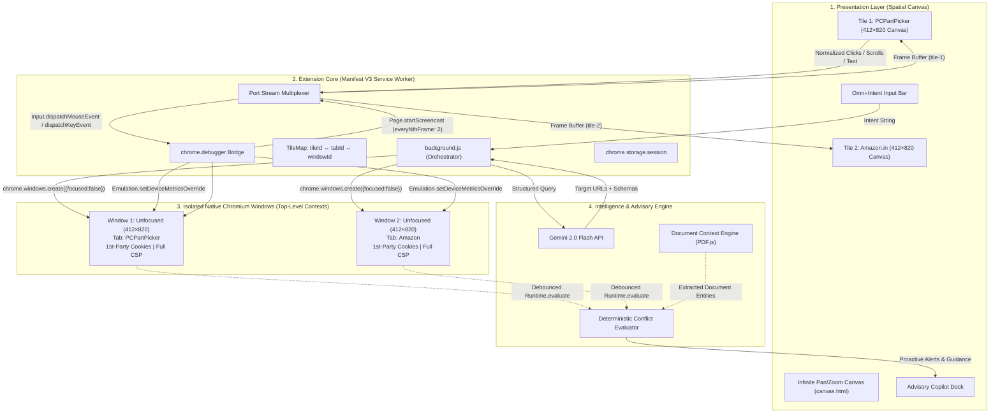

# MirrorCanvas: The Spatial Intent Cockpit
## Product & Technical Architecture Specification
**Track:** Beyond the Browser – Reimagining How We Use the Web  
**Version:** 1.0 (Hackathon Architecture Release)

---

## 1. Executive Summary & Vision

### 1.1 The Fundamental Flaw of the Modern Web: The "Human Middleware" Trap
Web browsing has been trapped in the same paradigm since tabbed browsing was introduced in the late 1990s. The real problem of the modern web is not a lack of information—it is **architectural isolation**:

1. **Tabs Are Blind, Deaf Islands:** Chrome treats every open tab as a completely isolated sandbox. Tab 1 (your train booking) has **zero awareness** of what is happening in Tab 2 (your hotel search) or Tab 3 (your transit map).
2. **Humans Are Forced to Be Dumb Middleware:** Because tabs cannot communicate, the human user is forced to be the glue:
   - Memorizing arrival times on Tab 1 while checking check-in policies on Tab 2.
   - Alt-tabbing 40 times to manually verify dates, clearances, and budgets across websites.
   - Performing mental arithmetic to track whether total spending exceeds personal limits.
3. **The Redundant Form-Filling Tax:** To complete any multi-site workflow, users re-type the exact same names, passport numbers, email addresses, and phone numbers across three or four separate websites—even though that exact data is **already sitting in a PDF or receipt in their local Downloads folder**.
4. **Silent Cross-Site Contradictions:** Because sites don't talk to each other, users regularly trigger catastrophic cross-site errors:
   - Booking a train that arrives at 4:15 PM, only to switch to the hotel tab and find out check-in closed at 2:00 PM.
   - Ordering a ₹60,000 graphics card, only to find during assembly that it is 15mm longer than their PC chassis interior.
   - Locking an apartment lease without realizing moving companies don't service that pincode on weekends.
5. **The False Dichotomy of Modern AI:**
   - **AI Chatbots (ChatGPT, Perplexity):** Generate static, dead text summaries. You cannot select a train berth, verify live seat availability, solve an OTP, or execute a transaction inside dead Markdown text. You are thrown back into the tab graveyard.
   - **Autonomous Vision Agents (Claude Computer Use, Operator):** Take 8–15 seconds per click, operate on one tab at a time, hallucinate frequently, and break instantly on CAPTCHAs, SMS 2FA, and bank fraud gates.

```
                  THE "HUMAN MIDDLEWARE" PARADIGM (TODAY)
┌──────────────────┐         ┌──────────────────┐         ┌──────────────────┐
│   TAB 1: IRCTC   │         │   TAB 2: AGODA   │         │ LOCAL DOWNLOADS  │
│ [Train Arr: 4PM] │         │[Check-in: 2PM ⚠️]│         │  [Passenger PDF] │
└────────┬─────────┘         └────────┬─────────┘         └────────┬─────────┘
         │                            │                            │
         ▼                            ▼                            ▼
   ┌─────────────────────────────────────────────────────────────────────┐
   │                     THE HUMAN USER (MIDDLEWARE)                     │
   │  • Manually copy-pasting dates between 4 tabs                       │
   │  • Re-typing passport details already saved on disk                 │
   │  • Mental arithmetic: "Am I still under ₹4,000 total?"              │
   │  • Alt-tabbing 50 times hoping no rules contradict                  │
   └─────────────────────────────────────────────────────────────────────┘
```

### 1.2 The Solution: MirrorCanvas
**MirrorCanvas** introduces the **Inter-Tab Cognitive Bus on an Infinite Spatial Canvas**:
- Replaces isolated tabs with **live, floating 2D website mirrors** running authentic Chrome sessions.
- An **Opinionated AI Copilot** sits on a shared cognitive bus across all tiles and your local files.
- It pulls passenger info from your local PDFs to auto-fill web forms with one click.
- It continuously monitors cross-site DOM states to catch silent schedule, budget, and dimension conflicts in real time.
- It provides honest human-agent collaboration: the human handles judgment, auth, and payment; the agent eliminates the middleware tax.

```
┌────────────────────────────────────────────────────────────────────────────────────────┐
│                                 THE PARADIGM EVOLUTION                                 │
├────────────────────────────┬────────────────────────────┬──────────────────────────────┤
│ TRADITIONAL BROWSER (1995) │ AI CHATBOTS (2023–2025)    │ MIRRORCANVAS (2026)          │
├────────────────────────────┼────────────────────────────┼──────────────────────────────┤
│ 25 isolated tabs           │ Single text chat box       │ Infinite 2D Spatial Canvas   │
│ Human is dumb middleware   │ AI describes the web       │ Shared Inter-Tab Cognitive Bus│
│ Zero cross-site awareness  │ Dead, read-only summaries  │ Cross-site conflict engine   │
│ Redundant manual data entry│ Cannot click, buy, or auth │ Local Document-to-Web Bridge │
│ Silent booking conflicts   │ Hallucination-prone        │ Collaborative Human+AI Deck  │
└────────────────────────────┴────────────────────────────┴──────────────────────────────┘
```

---

## 2. Feature Specification

```
┌────────────────────────────────────────────────────────────────────────────────────────┐
│                              MIRRORCANVAS FEATURE SUITE                                │
├───────────────────────────────┬────────────────────────────────────────────────────────┤
│ 1. Spatial Canvas Core        │ • Infinite 2D Pan/Zoom Canvas                          │
│                               │ • Multi-Tile Simultaneous Live Web Tele-Operation      │
│                               │ • Responsive Single-Column Stream Normalization        │
│                               │ • Multi-Tile Window Multiplexer (up to 4 active tiles) │
├───────────────────────────────┼────────────────────────────────────────────────────────┤
│ 2. Cognitive Copilot Engine   │ • Active Guidance: Step-by-step progress tracking      │
│                               │ • Decision Companion: Budget, schedule, tradeoff sync │
│                               │ • Local Document-to-Web Bridge (PDFs/receipts -> forms)│
│                               │ • Cross-Site Constraint Engine (Automatic conflict fix)│
│                               │ • "Let Me Handle It" Mechanical Form Takeover          │
├───────────────────────────────┼────────────────────────────────────────────────────────┤
│ 3. Next-Gen Earth-Breakers    │ • Cross-Site Semantic Drag & Drop (Data Teleportation) │
│                               │ • Workspace Decision Forking (Git for Web Browsing)    │
│                               │ • The Scissor Tool (Live Micro-Widget HUD Extraction)  │
│                               │ • The Context Pocket (Visual Entity Palette Autofill)  │
├───────────────────────────────┼────────────────────────────────────────────────────────┤
│ 4. Security & Trust Handoff   │ • Native Top-Level Session Preservation (Cookies/CHIPS)│
│                               │ • Zero-Credential-Exposure Keystroke Relay             │
│                               │ • 1-Click Native Checkout Handoff (100% Bank Security) │
│                               │ • In-Tile Human CAPTCHA & 2FA Resolution               │
└───────────────────────────────┴────────────────────────────────────────────────────────┘
```

### 2.1 Infinite Spatial Canvas
Instead of horizontal tab ribbons, websites float freely in 2D space:
- **Spatial Organizing:** Users arrange their workflows logically (e.g., Transit on the left, Lodging in the middle, Itinerary on the right).
- **Ratio-Based Input Relay:** Clicks, scrolls, and drag gestures are normalized ($X_{ratio} = \frac{x - left}{width}$) and dispatched over CDP, ensuring accurate interaction regardless of user zoom level ($50\%\dots200\%$).
- **Click-to-Focus Ring:** Clicking any tile highlights it with an active cyan focus indicator and routes virtual keyboard events directly to that tab.

### 2.2 Proactive Copilot: Active Guidance & Decision Tracking
The copilot is an active, opinionated decision partner that watches your progress across all tabs:
- **Progress & Step Tracking:** Keeps track of the multi-step journey (e.g., *"Step 1: Train Seat Selected ✅ ➔ Step 2: Hotel Locked ✅ ➔ Step 3: Transit Route Pending"*).
- **Active Decision Guidance:** Proactively evaluates tradeoffs in real time (e.g., *"You've picked a non-refundable room to save ₹200, but your train has a 30% historical delay rate. Consider the free cancellation tier for ₹2,400"*).
- **Omni-Intent Routing:** Parses broad goals (e.g. *"Weekend in Mysore under ₹4K"*) directly into deep-link search URLs, bypassing promotional landing pages.

### 2.3 Document-to-Web Bridge (Local PDF Ingestion)
- **Local File Inspection:** Reads user documents (PDF receipts, offer letters, national ID cards) client-side via the HTML5 File API and `chrome.downloads.search`.
- **Pre-Flight Confirmation:** Extracts key entities (Name, Date of Birth, Passport Number, Work Address) and presents a 1-click confirmation card before populating fields.
- **CDP Input Dispatch:** Injects validated strings into target input fields via `Input.insertText` without manual copy-pasting.

### 2.4 Real-Time Cross-Site Conflict Engine
Every 1.5 seconds following user interaction, DOM text is extracted via `Runtime.evaluate` and evaluated against structured schemas:
- **Temporal Alignment:** Continuously verifies arrival timestamps against hotel check-in hours and transit schedules.
- **Budget Tracking:** Sums line items across all open tiles against the user's hard ceiling, alerting when hidden fees push the total over budget.
- **Physical/Technical Compatibility:** Verifies clearance dimensions (GPU length vs. chassis interior) or component standards (DDR4 vs. DDR5).

### 2.5 1-Click Bank-Grade Checkout Handoff
- Auto-detects payment gateway domains (`Page.frameNavigated` tracking).
- Flashes a prominent `[🚀 PROCEED TO SECURE CHECKOUT]` action pill.
- Switches focus directly to the authentic native Chrome tab for 100% bank-grade UPI QR scan and 3D Secure 2FA, completely eliminating third-party security liability.

---

### 2.6 The 4 Earth-Breaking Capabilities (Technically Grounded Innovation)

These four breakthrough features are unlocked specifically because MirrorCanvas controls both the **spatial canvas interface** and the **underlying browser protocol (CDP)**:

#### 1. Cross-Site Semantic Drag & Drop (Data Teleportation) 💥
* **User Experience:** Click and drag any element—a hotel address from Agoda, a part number from PCPartPicker, or an invoice line-item from Stripe—and physically drop it onto another tile (e.g. Google Maps or Amazon). The target site immediately searches that entity.
* **Why It’s a Breakthrough:** Cross-origin drag-and-drop between independent websites is strictly prohibited in standard browsers.
* **Technical Feasibility:** The spatial canvas captures the drag coordinates on Tile A, extracts the semantic text via `Runtime.evaluate`, and upon drop on Tile B, triggers `Input.insertText` and `Input.dispatchKeyEvent` directly into Tile B's search input.

#### 2. Workspace Decision Forking ("Git for Web Browsing") 🌿
* **User Experience:** When torn between two viable paths (e.g., *Option A: "Budget Trip - Train + Homestay"* vs. *Option B: "Luxury Trip - Flight + Resort"*), click **`[🌿 Fork Canvas]`**. MirrorCanvas creates two discrete decision branches. Users toggle between Branch A and Branch B with one click; all tiles instantly restore their exact navigation states, cart contents, and form values.
* **Why It’s a Breakthrough:** Completely eliminates tab hoarding and decision fatigue during complex comparisons.
* **Technical Feasibility:** Each branch is a serialized JSON state tree saved in `chrome.storage.local` containing `{ tileId, url, scrollOffset, extractedEntities }`. Switching branches simply navigates background tabs to their respective state URLs.

#### 3. The Scissor Tool (Live Micro-Widget HUD Extraction) ✂️
* **User Experience:** Instead of viewing full mobile pages, users select the Scissor Tool and draw a bounding box around only the widget they care about (e.g. just the Amazon live cart total, or just the IRCTC seat vacancy counter). The tile collapses into a live, floating **Micro-Widget**.
* **Why It’s a Breakthrough:** Users construct bespoke, live multi-site monitoring dashboards in seconds.
* **Technical Feasibility:** The canvas applies a dynamic CSS `clip-path` and canvas transform matching the element's `getBoundingClientRect()`. Input ratio coordinates automatically re-scale to the cropped bounding box.

#### 4. The Context Pocket (Visual Entity Palette Autofill) 📂
* **User Experience:** A persistent side-dock where users drop local identity files (`passport.pdf`, `resume.pdf`, `offer_letter.pdf`). The copilot parses them into glowing interactive badges:
  `[👤 Name: Chakravarthi]` `[🆔 Passport: Z1234567]` `[📍 Address: 12th Main, Bangalore]`
  Clicking any badge instantly blasts that data into whichever input field is currently active on any tile.
* **Why It’s a Breakthrough:** Transforms local files into a universal, privacy-first autofill palette across the entire internet.
* **Technical Feasibility:** Client-side parsing via PDF.js. Badge click dispatches CDP `Input.insertText` directly to the active tabId. Zero cloud data storage.

---

## 3. Detailed Architectural Decisions



---

### 3.1 Architectural Decision 1: Background Tab Rendering via Dedicated Unfocused Windows

#### The Problem
Chromium aggressively optimizes resource utilization. When tabs run in the background (`active: false`) within the same browser window, Chromium's compositing pipeline halts paint updates. Consequently, `Page.startScreencast` produces zero frames or stalls after the initial paint. Clicks dispatch to the DOM, but visual feedback is completely frozen.

#### The Architectural Solution
MirrorCanvas spawns each target website inside its **own dedicated, unfocused browser window**:
```javascript
// background.js: Dedicated Window Creation Pattern
async function createMirroredTab(url) {
  const win = await chrome.windows.create({
    url: url,
    focused: false,        // Crucial: Keeps user focus on canvas
    width: 412,
    height: 820,
    type: 'normal'
  });
  
  const tabId = win.tabs[0].id;
  const windowId = win.id;
  
  // Tab is active within its own window -> Compositor renders continuously
  return { tabId, windowId };
}
```

#### Why This Works
1. Within its dedicated window, the tab is index `0` and marked `active: true`. Chromium treats it as a foreground surface and continues rasterizing frames.
2. The user remains focused on the canvas window.
3. If OS-level window occlusion throttling occurs on certain platforms, running with `--disable-backgrounding-occluded-windows` provides an unthrottled demo guarantee.
4. **Fallback:** If screencast stalls, the engine detects frame gaps $>500\text{ms}$ and falls back to event-driven `Page.captureScreenshot` on mouse and keyboard releases.

---

### 3.2 Architectural Decision 2: Why Naive Iframes Fail (And Why CDP is Essential)

Embedding third-party websites inside `<iframe>` tags within an extension origin (`chrome-extension://<id>`) encounters four hard browser security barriers:

```
┌────────────────────────────────────────────────────────────────────────────────────────┐
│                              THE IFRAME BREAKDOWN MATRIX                               │
├─────────────────────┬───────────────────────────────┬──────────────────────────────────┤
│ SECURITY MECHANISM  │ NAIVE IFRAME BEHAVIOR         │ MIRRORCANVAS (CDP TELE-OPERATION)│
├─────────────────────┼───────────────────────────────┼──────────────────────────────────┤
│ SameSite Cookies    │ Modern Chrome defaults to     │ Sites execute in authentic,      │
│ (Lax / Strict)      │ SameSite=Lax. Cookies are     │ top-level first-party contexts.  │
│                     │ stripped in cross-site frames.│ All cookies and sessions load    │
│                     │ User appears logged out.      │ natively without configuration.  │
├─────────────────────┼───────────────────────────────┼──────────────────────────────────┤
│ Storage Partition   │ Chrome partitions localStorage│ Unpartitioned native access.     │
│ (CHIPS)             │ and IndexedDB per top-level   │ Full access to existing portal   │
│                     │ site. State is invisible.     │ preferences and login tokens.    │
├─────────────────────┼───────────────────────────────┼──────────────────────────────────┤
│ Content-Security-   │ frame-ancestors 'none' and    │ No headers stripped. 100% of CSP │
│ Policy & Clickjack  │ X-Frame-Options: DENY block   │ defenses remain intact in the    │
│                     │ iframe rendering entirely.    │ real browser tab.                │
├─────────────────────┼───────────────────────────────┼──────────────────────────────────┤
│ Payment Gateways    │ JS frame-busting scripts      │ Payments are never framed.       │
│ & 3D Secure OTP     │ (top !== self) freeze checkout│ 1-Click Handoff transfers focus  │
│                     │ flows and trip RBI fraud rules│ directly to the top-level tab.   │
└─────────────────────┴───────────────────────────────┴──────────────────────────────────┘
```

> [!CAUTION]
> Stripping CSP and `X-Frame-Options` headers using `declarativeNetRequest` is a massive vulnerability. It disables browser XSS protections on financial sites and will trigger immediate rejection in security reviews. CDP tele-operation bypasses framing restrictions legitimately by hosting sites in native tabs and streaming visual output.

---

### 3.3 Architectural Decision 3: Multi-Tile Routing & State Multiplexing

To support multiple simultaneous tiles without IPC collisions, the Service Worker manages a centralized `TileMap`:

```typescript
interface TileState {
  tileId: string;
  tabId: number;
  windowId: number;
  url: string;
  status: 'initializing' | 'streaming' | 'detached' | 'dead';
  lastFrameTimestamp: number;
  viewport: { width: number; height: number };
}

const TileMap = new Map<string, TileState>();
```

#### Protocol Multiplexing Rules
- **Canvas to Service Worker:** All input events include the source `tileId`:
  ```json
  {"type": "CLICK", "tileId": "tile-1", "ratioX": 0.42, "ratioY": 0.68}
  ```
- **Service Worker to Canvas:** Screencast frames include metadata identifying the target tile:
  ```json
  {"type": "FRAME", "tileId": "tile-1", "data": "base64_jpeg_payload", "metadata": {...}}
  ```
- **Concurrency Cap:** The system enforces a maximum of **4 concurrent active streams** to preserve GPU compositing budgets and avoid thread saturation.

---

### 3.4 Architectural Decision 4: Navigation Defense & Window Trap Elimination

Web portals frequently invoke `target="_blank"` or `window.open()` during authentication and search flows, which would normally spawn unmonitored tabs and break canvas continuity.

#### Injected Navigation Neutralization
Upon attaching the debugger, MirrorCanvas invokes `Page.addScriptToEvaluateOnNewDocument`:

```javascript
await chrome.debugger.sendCommand({ tabId }, 'Page.addScriptToEvaluateOnNewDocument', {
  source: `
    // Trap 1: Neutralize target="_blank" anchors
    document.addEventListener('click', (e) => {
      const anchor = e.target.closest('a');
      if (anchor && anchor.target === '_blank') {
        anchor.target = '_self';
      }
    }, true);

    // Trap 2: Reroute window.open calls to self-navigation
    window.open = function(url) {
      if (url) window.location.href = url;
      return window;
    };
  `
});
```

#### Handling Legitimate OAuth Popups
When a site invokes Google SSO or Bank OAuth via third-party popup dialogs, the popup executes as a standard top-level browser dialog. The user completes authentication directly in the native dialog. Upon completion, the popup closes, the parent background tab receives the authentication token, and the canvas screencast reflects the logged-in dashboard.

---

### 3.5 Architectural Decision 5: Pure CDP Extraction (Zero Content Script Architecture)

```
TRADITIONAL ARCHITECTURE (FRAGILE):
Canvas ──(Port)──> Background ──(chrome.tabs.sendMessage)──> Injected Content Script ──> DOM
* Breaks during full-page reloads and SPA client transitions.
* Throws "Receiving end does not exist" errors.
* Re-injection fails on certain strict hosts.

MIRRORCANVAS ARCHITECTURE (RESILIENT):
Canvas ──(Port)──> Background ──(Runtime.evaluate via CDP)──> Isolated V8 Execution ──> DOM
* Operates at the engine level above the web application runtime.
* Survives cross-origin redirects, hard reloads, and history state changes.
* Zero external script injection footprint.
```

DOM extraction executes cleanly through CDP:
```javascript
async function extractPageSnapshot(tabId) {
  const evaluation = await chrome.debugger.sendCommand(
    { tabId },
    'Runtime.evaluate',
    {
      expression: `
        (() => {
          // Extract text content, stripping repetitive script and style payloads
          const clone = document.body.cloneNode(true);
          const removeSelectors = ['script', 'style', 'svg', 'noscript', 'nav', 'footer'];
          removeSelectors.forEach(sel => clone.querySelectorAll(sel).forEach(el => el.remove()));
          return clone.innerText.replace(/\\s+/g, ' ').substring(0, 3500);
        })()
      `,
      returnByValue: true
    }
  );
  return evaluation.result.value;
}
```

---

### 3.6 Architectural Decision 6: The Copilot Autonomy Model

To balance user agency with automated efficiency, system actions are partitioned into four discrete autonomy tiers:

```
┌────────────────────────────────────────────────────────────────────────────────────────┐
│                               THE AUTONOMY SPECTRUM                                    │
├───────────────┬───────────────────────────────┬────────────────────────────────────────┤
│ TIER          │ SYSTEM ACTION                 │ USER INTERACTION                       │
├───────────────┼───────────────────────────────┼────────────────────────────────────────┤
│ 🟢 SILENT     │ • Extract background DOM text │ Zero interruption.                     │
│    AUTOMATION │ • Update budget & time sync   │ Status appears dynamically             │
│               │ • Dismiss cookie consent banners│ in canvas status indicators.         │
├───────────────┼───────────────────────────────┼────────────────────────────────────────┤
│ 🔵 SUGGEST &  │ • Pre-fill passenger/user data│ Presents a 1-click prompt:             │
│    CONFIRM    │ • Re-route to cheaper options │ "[✅ Accept & Apply] [❌ Dismiss]"    │
│               │ • Spawn complementary tiles   │ System waits for explicit click.       │
├───────────────┼───────────────────────────────┼────────────────────────────────────────┤
│ 🟡 ADVISE &   │ • Flag non-refundable terms   │ Warning banners highlight in amber/red │
│    WARN       │ • Identify transit gaps       │ with actionable recommendations.      │
│               │ • Dimension mismatch alerts   │                                        │
├───────────────┼───────────────────────────────┼────────────────────────────────────────┤
│ 🔴 MANUAL-ONLY│ • Captcha challenge solving   │ User interacts directly with canvas.   │
│    GATES      │ • Password & OTP entry        │ Copilot does not record or interact.   │
│               │ • Final payment authorization │ Tab pops out to native window.         │
└───────────────┴───────────────────────────────┴────────────────────────────────────────┘
```

---

### 3.7 Architectural Decision 7: 1-Click Secure Payment Handoff

MirrorCanvas enforces a strict security boundary: **payment gateways and bank OTP verification pages are never tele-operated.**

```
                                  PAYMENT HANDOFF LIFECYCLE
                                  
   [ Canvas Tile A ]                                         [ Native Browser Context ]
           │                                                              │
 1. User reaches payment gate                                             │
    (Screencast detects payment URL)                                      │
           │                                                              │
 2. System flashes Checkout Pill:                                         │
    "[ 🚀 PROCEED TO SECURE CHECKOUT ]"                                   │
           │                                                              │
 3. User clicks Checkout Pill ───────( chrome.tabs.update )──────────────>│
                                      { active: true }                    │
                                                                 4. Window brought to focus
                                                                 5. Full native security active
                                                                 6. User completes UPI / 3DS OTP
                                                                          │
 7. User returns to Canvas <─────────( chrome.tabs.onUpdated )────────────┘
    Tile reflects confirmation state
```

```javascript
// background.js: Safe Handoff Handler
async function handoffToNativeCheckout(tabId, windowId) {
  // Bring the dedicated window and tab to native user focus
  await chrome.windows.update(windowId, { focused: true });
  await chrome.tabs.update(tabId, { active: true });
  
  // Pause screencasting to release GPU resources and prevent shoulder-surfing
  await chrome.debugger.sendCommand({ tabId }, 'Page.stopScreencast');
}
```

---

## 4. Universal Big Intent Workflows

MirrorCanvas supports complex multi-site workflows across diverse domains:

```
┌────────────────────────────────────────────────────────────────────────────────────────┐
│                              CROSS-DOMAIN INTENT MATRIX                                │
├──────────────────────┬──────────────────────────────┬──────────────────────────────────┤
│ INTENT               │ TARGET WEB SUITE             │ COPILOT REASONING ENGINE         │
├──────────────────────┼──────────────────────────────┼──────────────────────────────────┤
│ 🖥️ PC Hardware Build  │ • PCPartPicker               │ • Cross-references GPU length    │
│                      │ • Amazon.in / MDComputers    │   against chassis interior clearance.│
│                      │ • Reddit r/buildapc          │ • Calculates total wattage draw  │
│                      │                              │   and recommends PSU capacity.   │
│                      │                              │ • Compares real-time component   │
│                      │                              │   pricing across vendors.        │
├──────────────────────┼──────────────────────────────┼──────────────────────────────────┤
│ 📦 Relocation &      │ • NoBroker / Zillow          │ • Reads employee offer letter for│
│    Moving            │ • Porter (Packers & Movers)  │   work location & salary base.   │
│                      │ • Rentomojo (Furniture)      │ • Computes commute transit times │
│                      │                              │   from prospective apartments.   │
│                      │                              │ • Balances move-in dates with    │
│                      │                              │   furniture delivery windows.    │
├──────────────────────┼──────────────────────────────┼──────────────────────────────────┤
│ 💼 Client Onboarding │ • Stripe Billing             │ • Parses contract PDF from drive │
│    & Invoicing       │ • DocuSign                   │   for milestones & billing terms.│
│                      │ • Google Drive               │ • Pre-populates Stripe line items│
│                      │                              │   and validates tax IDs.         │
├──────────────────────┼──────────────────────────────┼──────────────────────────────────┤
│ 🎓 University        │ • Common App / Portal        │ • Ingests academic transcript PDF│
│    Applications      │ • Educational Credential Eval│ • Auto-fills personal histories  │
│                      │ • University Department Page │ • Tracks deadline disparities.   │
└──────────────────────┴──────────────────────────────┴──────────────────────────────────┘
```

---

## 5. Technical Trap Defense & Judge Matrix

*Key technical defenses for engineering evaluations and judging panels:*

### Q1: "Why not run headless Chromium in the cloud via Playwright/Puppeteer?"
**Defense:**
1. **Authentication:** Cloud instances do not share the user's existing browser cookies, saved passwords, or local state. The user would have to log into every service again on a remote server.
2. **Anti-Bot Blocking:** Cloud datacenter IPs (AWS, GCP, DigitalOcean) trigger instant Cloudflare, Akamai, and bot-defense blocks on sites like IRCTC, Ticketmaster, and Amazon.
3. **Data Privacy:** Routing financial and travel transactions through remote execution servers introduces significant liability and compliance overhead.
4. **Conclusion:** Running CDP locally inside the user's client uses their authenticated profile and residential IP address directly.

### Q2: "How does this differ from autonomous browser agents (e.g., Claude Computer Use)?"
**Defense:**
1. **Speed:** Autonomous vision agents introduce a 5–15 second latency per interaction, requiring expensive multimodal LLM calls for every action. MirrorCanvas operates with native 0ms local input relay.
2. **Trust Boundaries:** Autonomous agents struggle with CAPTCHAs, 2FA SMS prompts, and payment checkpoints. MirrorCanvas uses a collaborative cockpit model: the human handles sensitive auth/payment checkpoints, while the agent automates mechanical forms and performs cross-site analysis.
3. **Scope:** Existing agents operate on one tab sequentially. MirrorCanvas enables simultaneous spatial tele-operation across multiple live sites.

### Q3: "Does websites detect CDP via `navigator.webdriver`?"
**Defense:**
When attaching via extension APIs (`chrome.debugger`), Chromium hooks into an existing human user session. Unlike automated WebDriver/Selenium instances, `navigator.webdriver` evaluates to `false` by default. Because clicks and keystrokes originate from normalized human pointer interactions, behavioral telemetry evaluates as legitimate user traffic.

### Q4: "How do you control LLM token expenditures across multiple live pages?"
**Defense:**
The system uses a three-stage throttling pipeline:
1. **Client-Side Text Stripping:** Pages are pre-filtered via `Runtime.evaluate`, removing SVG, script, CSS, and navigation sludge, capping text at 3,500 characters.
2. **Debounce Gating:** Extraction triggers only after a 1.5-second pause in user interaction.
3. **Structural Difference Caching:** New snapshots are compared against cached hashes using Levenshtein distance thresholds; API calls execute only when meaningful page state changes occur ($>20\%$ diff).

### Q5: "How does this differ from Chrome's built-in 'Ask Gemini' reading multiple tabs?"
**Defense:**
This is the fundamental distinction between a **passive read-only sidebar chatbot** and an **interactive spatial cockpit**:

```
┌─────────────────────────────┬─────────────────────────────────┬─────────────────────────────────┐
│ CAPABILITY                  │ CHROME "ASK GEMINI" (SIDE PANEL)│ MIRRORCANVAS (SPATIAL COCKPIT)  │
├─────────────────────────────┼─────────────────────────────────┼─────────────────────────────────┤
│ Output Type                 │ Dead text in a cramped sidebar. │ Live, interactive 2D web tiles. │
│ Can It Click or Type?       │ ❌ Zero in-page execution.       │ ✅ Bi-directional action via CDP│
│                             │ Cannot select seats or fill.    │ (`Input.insertText`, clicks).   │
├─────────────────────────────┼─────────────────────────────────┼─────────────────────────────────┤
│ Document-to-Web Bridge      │ ❌ Cannot read local downloads   │ ✅ Reads local PDFs and injects │
│                             │ or inject data into web forms.  │ passenger data in 1 click.      │
├─────────────────────────────┼─────────────────────────────────┼─────────────────────────────────┤
│ Workflow Architecture       │ ❌ You still have 25 open tabs; │ ✅ Replaces the tab bar with a  │
│                             │ still alt-tabbing manually.     │ unified spatial visual plane.   │
├─────────────────────────────┼─────────────────────────────────┼─────────────────────────────────┤
│ Cross-Site Conflict Action  │ ❌ Describes conflicts in text; │ ✅ Spatially visualizes conflict│
│                             │ you still fix them manually.    │ with 1-click active switch.     │
├─────────────────────────────┼─────────────────────────────────┼─────────────────────────────────┤
│ Payment & Security          │ ❌ Leaves user to pay in tabs.  │ ✅ 1-click popout to native tab │
│                             │                                 │ for bank UPI/3D Secure.         │
└─────────────────────────────┴─────────────────────────────────┴─────────────────────────────────┘
```
> *"Ask Gemini is a **one-way read pipeline**—it reads DOM text and dumps a summary into a sidebar, forcing you to do 100% of the manual clicking and typing yourself. MirrorCanvas is a **two-way tele-operated cockpit**—it lives on an inter-tab cognitive bus that auto-fills forms from your PDFs, reconciles conflicts with one-click actions, and lets you interact with multiple live authenticated sites on a single spatial surface."*

---

## 6. Implementation Architecture & File Structure

```
mirror-canvas-extension/
├── manifest.json              # MV3 specification (debugger, tabs, downloads)
├── background.js              # Service Worker: Window lifecycle, CDP mux, TileMap
├── canvas.html                # Main interface: Omni-bar, 2D spatial canvas, copilot dock
├── canvas.css                 # Spatial styling, card elevations, focus states
├── canvas.js                  # Ratio coordinate math, input event listeners, viewport pan/zoom
└── assets/
    └── icons/                 # Extension toolbar branding
```

---

## 7. Master Video Pitch Script (The "Human Middleware" Narrative)

* **Duration:** ~2 Minutes 20 Seconds  
* **Structure:** Problem ➔ Solution One-by-One ➔ Features & Earth-Breakers ➔ Technical Blockbusters ➔ Impact

### Part 1: The Problem — The "Human Middleware" Tax (0:00 – 0:30)
> *"The fundamental flaw of the modern web isn't information—it's **isolation**.  
> Chrome treats every tab as a digital island. Tab 1 has zero idea what is happening in Tab 2.  
> And because tabs can't talk to each other, **you are forced to be the dumb middleware**—copy-pasting dates into scratchpads, calculating budgets in your head, and re-typing your name and passport across four different forms even though that exact data is already sitting in a PDF on your laptop.  
> And AI chatbots? They just spit out dead text summaries. You can't select a seat, you can't log in, and you can't buy. The moment you want to act, you're thrown right back into the tab graveyard."*

### Part 2: The Solution One-by-One (0:30 – 0:55)
> *"Tabs were invented in 1995. This is **MirrorCanvas: The Spatial Intent Cockpit**.  
> We solve this with three fundamental shifts:  
> **One:** We replace horizontal tabs with an infinite 2D spatial canvas where websites float as live, interactive mirrors side by side.  
> **Two:** We replace tab isolation with a **Shared Inter-Tab Cognitive Bus**—an AI copilot that watches all your tabs simultaneously and reconciles them.  
> **Three:** We bridge your local documents directly to the web, so your computer actually works for you."*

### Part 3: Features & Earth-Breakers in Action (0:55 – 1:35)
> *"Watch it in action.  
> First, the **Document-to-Web Bridge**. The copilot inspects my local downloads, pulls my passenger details from a PDF, and auto-fills the booking form in one click. Zero manual data entry.  
> Next, **Cross-Tab Consciousness**. I pick an afternoon train, and the copilot immediately flags a silent disaster: the train arrives two hours after hotel check-in! It doesn't just warn me—it finds an earlier train that saves ₹365 and gets me there on time. One click, conflict solved.  
> Plus, earth-breaking features browsers could never do: **Semantic Drag & Drop** to teleport data between independent websites, and the **Scissor Tool** to crop live sites into custom micro-widgets."*

### Part 4: Technical Blockbusters (1:35 – 2:05)
> *"Now, the technical blockbusters that make this real:  
> Why not naive iframes? Because modern sites block iframes with CSP, SameSite=Lax strips cookies, and bank payment gateways freeze.  
> Instead, MirrorCanvas runs authentic Chrome sessions tele-operated over the **Chrome DevTools Protocol (CDP)**. Your logins, cookies, and sessions work natively. We extract DOM state via `Runtime.evaluate` with zero flaky content scripts.  
> And our background compositing fix? Each site runs in its own dedicated, unfocused window so Chromium never stops rendering frames.  
> When it’s time to pay, our **1-Click Secure Handoff** brings the real tab to the foreground. Zero credential leakage. 100% native bank-grade UPI and 3D Secure protection."*

### Part 5: Impact & Vision (2:05 – 2:20)
> *"Stop acting like a copy-paste bridge between isolated tabs.  
> Stop settling for AI chatbots that can only talk about the web.  
> MirrorCanvas is the spatial cockpit for the living, authenticated web.  
> Built by Team [Your Team Name] for Track 2. Thank you."*

---

## 8. Conclusion
MirrorCanvas replaces the outdated 1995 tab paradigm with a modern spatial interface. By bridging **local CDP tele-operation** with a **proactive AI copilot**, it eliminates the fragmentation of multi-tab workflows without breaking authentication, violating web security standards, or relying on fragile browser scraping.
