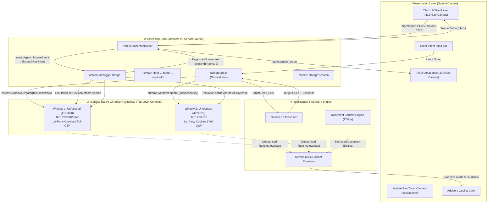

# MirrorCanvas: The Spatial Intent Cockpit
## Product & Technical Architecture Specification
**Track:** Beyond the Browser – Reimagining How We Use the Web  
**Version:** 1.0 (Hackathon Architecture Release)

---

## 1. Executive Summary & Vision

### 1.1 The Fundamental Flaw of the Modern Web
Web browsing has been stuck in the same mental model since Netscape Navigator launched tabbed browsing in the late 1990s:
1. **The Tab Silo Problem:** Complex human objectives (booking multi-leg transit, configuring custom PC hardware, relocating to a new city, or executing vendor onboarding) require 15 to 30 open tabs. Tabs are blind, deaf, and isolated from one another. The entire burden of data extraction, mental arithmetic, compatibility checking, and schedule alignment falls on the human.
2. **The "Dead Summary" Trap of AI Agents:** Modern AI search tools (Perplexity, Arc, Google AI Overviews) and autonomous browser agents operate on an all-or-nothing dichotomy:
   - **Chatbots generate static text summaries:** They tell you *about* trains or hotel prices, but you cannot select seats, verify live room availability, solve a bank CAPTCHA, or execute a transaction inside dead Markdown text.
   - **Autonomous agents (Claude Computer Use, OpenAI Operator) are sluggish and brittle:** They take 8–15 seconds per click over remote vision loops, break instantly on Cloudflare challenges or 2FA SMS gates, and operate sequentially on one tab at a time.
3. **Web Sludge & Friction:** 75% of desktop web screen real estate is consumed by cookie banners, autoplay video carousels, sticky newsletter overlays, and bloated navigation headers.

```
┌────────────────────────────────────────────────────────────────────────────────────────┐
│                                 THE PARADIGM EVOLUTION                                 │
├────────────────────────────┬────────────────────────────┬──────────────────────────────┤
│ TRADITIONAL BROWSER (1995) │ AI CHATBOTS (2023–2025)    │ MIRRORCANVAS (2026)          │
├────────────────────────────┼────────────────────────────┼──────────────────────────────┤
│ 25 isolated tabs           │ Single text chat box       │ Infinite 2D Spatial Canvas   │
│ User alt-tabs & copy-pastes│ AI describes the web       │ Live authenticated web tiles │
│ Zero cross-site awareness  │ Dead, read-only summaries  │ Cross-site conflict engine   │
│ 80% ad & sludge clutter    │ Cannot click, buy, or auth │ Mobile-emulated clean DOM    │
│ Pure manual labor          │ Hallucination-prone        │ Ground-truth live sites + AI │
└────────────────────────────┴────────────────────────────┴──────────────────────────────┘
```

### 1.2 The Solution: MirrorCanvas
**MirrorCanvas** transforms the browser into an **infinite, collaborative spatial cockpit**:
- The user issues a high-level intent (e.g., *"Weekend in Mysore: Train + Heritage Stay under ₹4,000"*).
- MirrorCanvas launches real, authenticated websites as **live, floating 2D tiles** using the Chrome DevTools Protocol (CDP).
- An **Opinionated AI Copilot** monitors all tiles simultaneously: it auto-fills mechanical forms using context from local documents (PDFs, download receipts), suggests better prices and routes, warns against hidden policy traps, and performs live cross-site conflict calculations.
- When it's time to pay, a **1-Click Secure Handoff** brings the native browser tab into focus for 100% bank-grade UPI/OTP completion with zero security tampering.

---

## 2. Feature Specification

```
┌────────────────────────────────────────────────────────────────────────────────────────┐
│                              MIRRORCANVAS FEATURE SUITE                                │
├───────────────────────────────┬────────────────────────────────────────────────────────┤
│ Spatial Canvas Core           │ • Infinite 2D Pan/Zoom Canvas                          │
│                               │ • Multi-Tile Tele-Operation (Clicks, Scroll, Typing)   │
│                               │ • Clean Mobile Viewport Stripping (412×820)           │
│                               │ • Multi-Tile Window Multiplexer (up to 4 active tiles) │
├───────────────────────────────┼────────────────────────────────────────────────────────┤
│ AI Copilot & Cognition        │ • Omni-Intent Parser (Intent → Deep Search Links)      │
│                               │ • The Autonomy Spectrum (Silent, Suggest, Advise)      │
│                               │ • Document Context Ingestion (PDF transcripts, IDs)    │
│                               │ • "Let Me Handle It" Mechanical Form Takeover          │
│                               │ • Cross-Tile Real-Time Conflict Engine                 │
│                               │ • Hidden Policy & Fine-Print Trap Detector             │
├───────────────────────────────┼────────────────────────────────────────────────────────┤
│ Security & Trust Boundaries   │ • Native Top-Level Session Preservation (Cookies/CHIPS)│
│                               │ • Zero-Credential-Exposure Keystroke Relay             │
│                               │ • Auto-Detecting Payment Gateway Pop-Out               │
│                               │ • Cloudflare/CAPTCHA In-Tile Manual Bypass             │
└───────────────────────────────┴────────────────────────────────────────────────────────┘
```

### 2.1 Infinite Spatial Canvas
Instead of horizontal tab ribbons, tiles float freely in 2D space:
- **Spatial Positioning:** Users arrange tasks logically (e.g., Transit on the left, Lodging in the middle, Itinerary on the right).
- **Ratio-Based Input Relay:** Clicks, scrolls, and drag gestures are normalized ($X_{ratio} = \frac{x - left}{width}$) and dispatched over CDP, ensuring accurate interaction regardless of user zoom level ($50\%\dots200\%$).
- **Click-to-Focus Ring:** Clicking any tile highlights it with a blue focus indicator and routes virtual keyboard events directly to that tab.

### 2.2 Live Mobile-Emulated Mirrors
Desktop web pages are overloaded with promotional clutter. MirrorCanvas uses CDP `Emulation.setDeviceMetricsOverride` (412×820, deviceScaleFactor: 2, mobile: true):
- **Strips 70% of UI Sludge:** Eliminates mega-menus, sticky headers, sidebar ads, and whitespace gutters.
- **Touch-Friendly Layouts:** Prompts responsive portals (IRCTC, Agoda, Amazon) to render clean single-column cards.
- **Consistent Scaling:** Guarantees 1:1 coordinate alignment between canvas mouse events and browser DOM targets.

### 2.3 Proactive Advisory Intelligence (The Opinionated Copilot)
The copilot is an active collaborator, not a passive search box:
- **Price & Schedule Optimization:** Flags superior alternatives (e.g., *"The 6:00 AM Shatabdi is ₹365 cheaper, saves 4 hours, and aligns with your hotel check-in"*).
- **Fine-Print & Trap Warnings:** Reads terms buried in accordion menus (e.g., non-refundable booking flags, convenience fee surcharges, dimensional incompatibilities).
- **Context-Aware Dynamic Expansion:** Suggests relevant secondary services mid-session (e.g., prompting for transit maps once a hotel is selected, or suggesting a CPU cooler when picking a tray processor).

### 2.4 Document Context & Smart Form Pre-Fill
- **Local File Inspection:** Reads user documents (PDF receipts, offer letters, national ID cards) via the HTML5 File API and `chrome.downloads.search`.
- **Pre-Flight Confirmation:** The copilot extracts fields (Name, Date of Birth, Passport Number, Work Address) and presents a 1-click confirmation card before populating fields.
- **CDP Input Dispatch:** Injects validated strings into target input fields via `Input.insertText`.

### 2.5 Real-Time Cross-Site Conflict Engine
Every 1.5 seconds following user interaction, DOM text is extracted via `Runtime.evaluate` and evaluated against structured schemas:
- **Temporal Alignment:** Checks arrival timestamps against hotel check-in hours.
- **Budget Tracking:** Sums line items across all open tiles against the user's hard ceiling.
- **Physical/Technical Compatibility:** Verifies clearance dimensions (GPU length vs. chassis interior) or component standards (DDR4 vs. DDR5).

---

## 3. Detailed Architectural Decisions



---

### 3.1 Architectural Decision 1: Background Tab Rendering via Dedicated Unfocused Windows

#### The Problem
Chromium aggressively optimizes resource utilization. When tabs run in the background (`active: false`) within the same browser window, Chromium's compositing pipeline halts paint updates. Consequently, `Page.startScreencast` produces zero frames or stalls after the initial paint. Clicks dispatch to the DOM, but visual feedback is completely frozen.

#### The Architectural Solution
MirrorCanvas spawns each target website inside its **own dedicated, unfocused browser window**:
```javascript
// background.js: Dedicated Window Creation Pattern
async function createMirroredTab(url) {
  const win = await chrome.windows.create({
    url: url,
    focused: false,        // Crucial: Keeps user focus on canvas
    width: 412,
    height: 820,
    type: 'normal'
  });
  
  const tabId = win.tabs[0].id;
  const windowId = win.id;
  
  // Tab is active within its own window -> Compositor renders continuously
  return { tabId, windowId };
}
```

#### Why This Works
1. Within its dedicated window, the tab is index `0` and marked `active: true`. Chromium treats it as a foreground surface and continues rasterizing frames.
2. The user remains focused on the canvas window.
3. If OS-level window occlusion throttling occurs on certain platforms, running with `--disable-backgrounding-occluded-windows` provides an unthrottled demo guarantee.
4. **Fallback:** If screencast stalls, the engine detects frame gaps $>500\text{ms}$ and falls back to event-driven `Page.captureScreenshot` on mouse and keyboard releases.

---

### 3.2 Architectural Decision 2: Why Naive Iframes Fail (And Why CDP is Essential)

Embedding third-party websites inside `<iframe>` tags within an extension origin (`chrome-extension://<id>`) encounters four hard browser security barriers:

```
┌────────────────────────────────────────────────────────────────────────────────────────┐
│                              THE IFRAME BREAKDOWN MATRIX                               │
├─────────────────────┬───────────────────────────────┬──────────────────────────────────┤
│ SECURITY MECHANISM  │ NAIVE IFRAME BEHAVIOR         │ MIRRORCANVAS (CDP TELE-OPERATION)│
├─────────────────────┼───────────────────────────────┼──────────────────────────────────┤
│ SameSite Cookies    │ Modern Chrome defaults to     │ Sites execute in authentic,      │
│ (Lax / Strict)      │ SameSite=Lax. Cookies are     │ top-level first-party contexts.  │
│                     │ stripped in cross-site frames.│ All cookies and sessions load    │
│                     │ User appears logged out.      │ natively without configuration.  │
├─────────────────────┼───────────────────────────────┼──────────────────────────────────┤
│ Storage Partition   │ Chrome partitions localStorage│ Unpartitioned native access.     │
│ (CHIPS)             │ and IndexedDB per top-level   │ Full access to existing portal   │
│                     │ site. State is invisible.     │ preferences and login tokens.    │
├─────────────────────┼───────────────────────────────┼──────────────────────────────────┤
│ Content-Security-   │ frame-ancestors 'none' and    │ No headers stripped. 100% of CSP │
│ Policy & Clickjack  │ X-Frame-Options: DENY block   │ defenses remain intact in the    │
│                     │ iframe rendering entirely.    │ real browser tab.                │
├─────────────────────┼───────────────────────────────┼──────────────────────────────────┤
│ Payment Gateways    │ JS frame-busting scripts      │ Payments are never framed.       │
│ & 3D Secure OTP     │ (top !== self) freeze checkout│ 1-Click Handoff transfers focus  │
│                     │ flows and trip RBI fraud rules│ directly to the top-level tab.   │
└─────────────────────┴───────────────────────────────┴──────────────────────────────────┘
```

> [!CAUTION]
> Stripping CSP and `X-Frame-Options` headers using `declarativeNetRequest` is a massive vulnerability. It disables browser XSS protections on financial sites and will trigger immediate rejection in security reviews. CDP tele-operation bypasses framing restrictions legitimately by hosting sites in native tabs and streaming visual output.

---

### 3.3 Architectural Decision 3: Multi-Tile Routing & State Multiplexing

To support multiple simultaneous tiles without IPC collisions, the Service Worker manages a centralized `TileMap`:

```typescript
interface TileState {
  tileId: string;
  tabId: number;
  windowId: number;
  url: string;
  status: 'initializing' | 'streaming' | 'detached' | 'dead';
  lastFrameTimestamp: number;
  viewport: { width: number; height: number };
}

const TileMap = new Map<string, TileState>();
```

#### Protocol Multiplexing Rules
- **Canvas to Service Worker:** All input events include the source `tileId`:
  ```json
  {"type": "CLICK", "tileId": "tile-1", "ratioX": 0.42, "ratioY": 0.68}
  ```
- **Service Worker to Canvas:** Screencast frames include metadata identifying the target tile:
  ```json
  {"type": "FRAME", "tileId": "tile-1", "data": "base64_jpeg_payload", "metadata": {...}}
  ```
- **Concurrency Cap:** The system enforces a maximum of **4 concurrent active streams** to preserve GPU compositing budgets and avoid thread saturation.

---

### 3.4 Architectural Decision 4: Navigation Defense & Window Trap Elimination

Web portals frequently invoke `target="_blank"` or `window.open()` during authentication and search flows, which would normally spawn unmonitored tabs and break canvas continuity.

#### Injected Navigation Neutralization
Upon attaching the debugger, MirrorCanvas invokes `Page.addScriptToEvaluateOnNewDocument`:

```javascript
await chrome.debugger.sendCommand({ tabId }, 'Page.addScriptToEvaluateOnNewDocument', {
  source: `
    // Trap 1: Neutralize target="_blank" anchors
    document.addEventListener('click', (e) => {
      const anchor = e.target.closest('a');
      if (anchor && anchor.target === '_blank') {
        anchor.target = '_self';
      }
    }, true);

    // Trap 2: Reroute window.open calls to self-navigation
    window.open = function(url) {
      if (url) window.location.href = url;
      return window;
    };
  `
});
```

#### Handling Legitimate OAuth Popups
When a site invokes Google SSO or Bank OAuth via third-party popup dialogs, the popup executes as a standard top-level browser dialog. The user completes authentication directly in the native dialog. Upon completion, the popup closes, the parent background tab receives the authentication token, and the canvas screencast reflects the logged-in dashboard.

---

### 3.5 Architectural Decision 5: Pure CDP Extraction (Zero Content Script Architecture)

```
TRADITIONAL ARCHITECTURE (FRAGILE):
Canvas ──(Port)──> Background ──(chrome.tabs.sendMessage)──> Injected Content Script ──> DOM
* Breaks during full-page reloads and SPA client transitions.
* Throws "Receiving end does not exist" errors.
* Re-injection fails on certain strict hosts.

MIRRORCANVAS ARCHITECTURE (RESILIENT):
Canvas ──(Port)──> Background ──(Runtime.evaluate via CDP)──> Isolated V8 Execution ──> DOM
* Operates at the engine level above the web application runtime.
* Survives cross-origin redirects, hard reloads, and history state changes.
* Zero external script injection footprint.
```

DOM extraction executes cleanly through CDP:
```javascript
async function extractPageSnapshot(tabId) {
  const evaluation = await chrome.debugger.sendCommand(
    { tabId },
    'Runtime.evaluate',
    {
      expression: `
        (() => {
          // Extract text content, stripping repetitive script and style payloads
          const clone = document.body.cloneNode(true);
          const removeSelectors = ['script', 'style', 'svg', 'noscript', 'nav', 'footer'];
          removeSelectors.forEach(sel => clone.querySelectorAll(sel).forEach(el => el.remove()));
          return clone.innerText.replace(/\\s+/g, ' ').substring(0, 3500);
        })()
      `,
      returnByValue: true
    }
  );
  return evaluation.result.value;
}
```

---

### 3.6 Architectural Decision 6: The Copilot Autonomy Model

To balance user agency with automated efficiency, system actions are partitioned into four discrete autonomy tiers:

```
┌────────────────────────────────────────────────────────────────────────────────────────┐
│                               THE AUTONOMY SPECTRUM                                    │
├───────────────┬───────────────────────────────┬────────────────────────────────────────┤
│ TIER          │ SYSTEM ACTION                 │ USER INTERACTION                       │
├───────────────┼───────────────────────────────┼────────────────────────────────────────┤
│ 🟢 SILENT     │ • Extract background DOM text │ Zero interruption.                     │
│    AUTOMATION │ • Update budget & time sync   │ Status appears dynamically             │
│               │ • Dismiss cookie consent banners│ in canvas status indicators.         │
├───────────────┼───────────────────────────────┼────────────────────────────────────────┤
│ 🔵 SUGGEST &  │ • Pre-fill passenger/user data│ Presents a 1-click prompt:             │
│    CONFIRM    │ • Re-route to cheaper options │ "[✅ Accept & Apply] [❌ Dismiss]"    │
│               │ • Spawn complementary tiles   │ System waits for explicit click.       │
├───────────────┼───────────────────────────────┼────────────────────────────────────────┤
│ 🟡 ADVISE &   │ • Flag non-refundable terms   │ Warning banners highlight in amber/red │
│    WARN       │ • Identify transit gaps       │ with actionable recommendations.      │
│               │ • Dimension mismatch alerts   │                                        │
├───────────────┼───────────────────────────────┼────────────────────────────────────────┤
│ 🔴 MANUAL-ONLY│ • Captcha challenge solving   │ User interacts directly with canvas.   │
│    GATES      │ • Password & OTP entry        │ Copilot does not record or interact.   │
│               │ • Final payment authorization │ Tab pops out to native window.         │
└───────────────┴───────────────────────────────┴────────────────────────────────────────┘
```

---

### 3.7 Architectural Decision 7: 1-Click Secure Payment Handoff

MirrorCanvas enforces a strict security boundary: **payment gateways and bank OTP verification pages are never tele-operated.**

```
                                  PAYMENT HANDOFF LIFECYCLE
                                  
   [ Canvas Tile A ]                                         [ Native Browser Context ]
           │                                                              │
 1. User reaches payment gate                                             │
    (Screencast detects payment URL)                                      │
           │                                                              │
 2. System flashes Checkout Pill:                                         │
    "[ 🚀 PROCEED TO SECURE CHECKOUT ]"                                   │
           │                                                              │
 3. User clicks Checkout Pill ───────( chrome.tabs.update )──────────────>│
                                      { active: true }                    │
                                                                 4. Window brought to focus
                                                                 5. Full native security active
                                                                 6. User completes UPI / 3DS OTP
                                                                          │
 7. User returns to Canvas <─────────( chrome.tabs.onUpdated )────────────┘
    Tile reflects confirmation state
```

```javascript
// background.js: Safe Handoff Handler
async function handoffToNativeCheckout(tabId, windowId) {
  // Bring the dedicated window and tab to native user focus
  await chrome.windows.update(windowId, { focused: true });
  await chrome.tabs.update(tabId, { active: true });
  
  // Pause screencasting to release GPU resources and prevent shoulder-surfing
  await chrome.debugger.sendCommand({ tabId }, 'Page.stopScreencast');
}
```

---

## 4. Universal Big Intent Workflows

MirrorCanvas supports complex multi-site workflows across diverse domains:

```
┌────────────────────────────────────────────────────────────────────────────────────────┐
│                              CROSS-DOMAIN INTENT MATRIX                                │
├──────────────────────┬──────────────────────────────┬──────────────────────────────────┤
│ INTENT               │ TARGET WEB SUITE             │ COPILOT REASONING ENGINE         │
├──────────────────────┼──────────────────────────────┼──────────────────────────────────┤
│ 🖥️ PC Hardware Build  │ • PCPartPicker               │ • Cross-references GPU length    │
│                      │ • Amazon.in / MDComputers    │   against chassis interior clearance.│
│                      │ • Reddit r/buildapc          │ • Calculates total wattage draw  │
│                      │                              │   and recommends PSU capacity.   │
│                      │                              │ • Compares real-time component   │
│                      │                              │   pricing across vendors.        │
├──────────────────────┼──────────────────────────────┼──────────────────────────────────┤
│ 📦 Relocation &      │ • NoBroker / Zillow          │ • Reads employee offer letter for│
│    Moving            │ • Porter (Packers & Movers)  │   work location & salary base.   │
│                      │ • Rentomojo (Furniture)      │ • Computes commute transit times │
│                      │                              │   from prospective apartments.   │
│                      │                              │ • Balances move-in dates with    │
│                      │                              │   furniture delivery windows.    │
├──────────────────────┼──────────────────────────────┼──────────────────────────────────┤
│ 💼 Client Onboarding │ • Stripe Billing             │ • Parses contract PDF from drive │
│    & Invoicing       │ • DocuSign                   │   for milestones & billing terms.│
│                      │ • Google Drive               │ • Pre-populates Stripe line items│
│                      │                              │   and validates tax IDs.         │
├──────────────────────┼──────────────────────────────┼──────────────────────────────────┤
│ 🎓 University        │ • Common App / Portal        │ • Ingests academic transcript PDF│
│    Applications      │ • Educational Credential Eval│ • Auto-fills personal histories  │
│                      │ • University Department Page │ • Tracks deadline disparities.   │
└──────────────────────┴──────────────────────────────┴──────────────────────────────────┘
```

---

## 5. Technical Trap Defense & Judge Matrix

*Key technical defenses for engineering evaluations and judging panels:*

### Q1: "Why not run headless Chromium in the cloud via Playwright/Puppeteer?"
**Defense:**
1. **Authentication:** Cloud instances do not share the user's existing browser cookies, saved passwords, or local state. The user would have to log into every service again on a remote server.
2. **Anti-Bot Blocking:** Cloud datacenter IPs (AWS, GCP, DigitalOcean) trigger instant Cloudflare, Akamai, and bot-defense blocks on sites like IRCTC, Ticketmaster, and Amazon.
3. **Data Privacy:** Routing financial and travel transactions through remote execution servers introduces significant liability and compliance overhead.
4. **Conclusion:** Running CDP locally inside the user's client uses their authenticated profile and residential IP address directly.

### Q2: "How does this differ from autonomous browser agents (e.g., Claude Computer Use)?"
**Defense:**
1. **Speed:** Autonomous vision agents introduce a 5–15 second latency per interaction, requiring expensive multimodal LLM calls for every action. MirrorCanvas operates with native 0ms local input relay.
2. **Trust Boundaries:** Autonomous agents struggle with CAPTCHAs, 2FA SMS prompts, and payment checkpoints. MirrorCanvas uses a collaborative cockpit model: the human handles sensitive auth/payment checkpoints, while the agent automates mechanical forms and performs cross-site analysis.
3. **Scope:** Existing agents operate on one tab sequentially. MirrorCanvas enables simultaneous spatial tele-operation across multiple live sites.

### Q3: "Does websites detect CDP via `navigator.webdriver`?"
**Defense:**
When attaching via extension APIs (`chrome.debugger`), Chromium hooks into an existing human user session. Unlike automated WebDriver/Selenium instances, `navigator.webdriver` evaluates to `false` by default. Because clicks and keystrokes originate from normalized human pointer interactions, behavioral telemetry evaluates as legitimate user traffic.

### Q4: "How do you control LLM token expenditures across multiple live pages?"
**Defense:**
The system uses a three-stage throttling pipeline:
1. **Client-Side Text Stripping:** Pages are pre-filtered via `Runtime.evaluate`, removing SVG, script, CSS, and navigation sludge, capping text at 3,500 characters.
2. **Debounce Gating:** Extraction triggers only after a 1.5-second pause in user interaction.
3. **Structural Difference Caching:** New snapshots are compared against cached hashes using Levenshtein distance thresholds; API calls execute only when meaningful page state changes occur ($>20\%$ diff).

---

## 6. Implementation Architecture & File Structure

```
mirror-canvas-extension/
├── manifest.json              # MV3 specification (debugger, tabs, downloads)
├── background.js              # Service Worker: Window lifecycle, CDP mux, TileMap
├── canvas.html                # Main interface: Omni-bar, 2D spatial canvas, copilot dock
├── canvas.css                 # Spatial styling, card elevations, focus states
├── canvas.js                  # Ratio coordinate math, input event listeners, viewport pan/zoom
└── assets/
    └── icons/                 # Extension toolbar branding
```

---

## 7. Conclusion
MirrorCanvas replaces the outdated 1995 tab paradigm with a modern spatial interface. By bridging **local CDP tele-operation** with a **proactive AI copilot**, it eliminates the fragmentation of multi-tab workflows without breaking authentication, violating web security standards, or relying on fragile browser scraping.
